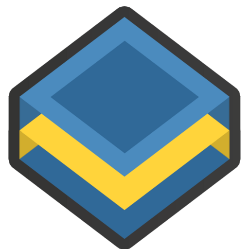

<div class="jam-hero" markdown>

{ .jam-logo }

<p class="jam-kicker">Python · Jinja · static output</p>

# Write Markdown. Ship a site.

<p class="jam-lede">jamstack turns a folder of Markdown and Jinja templates into
a fast static site. Three runtime dependencies, no JavaScript toolchain, and no
network access during a build.</p>

[Start the tutorial](tutorial.md){ .md-button .md-button--primary }
[Install](#install){ .md-button }

</div>

!!! info "Version 2.0"

    This documentation covers the 2.0 engine. Projects built with 1.x need the
    conversion described in [Migration from 1.x](migration.md).

## Install

```bash
python -m pip install jamstack
```

Python 3.11 or newer.

## Quick start

```bash
jamstack init my-site --theme blog
cd my-site
jamstack build
jamstack serve
```

Your site lands in `dist/` and is served at `http://127.0.0.1:8000/`. Edit
anything under `content/` and the page rebuilds on the next save.

## What you get

<div class="jam-features" markdown>

<div markdown>
**Markdown or Jinja.** Posts in Markdown with TOML front matter, or an `.html`
file when you want full control of the markup.
</div>

<div markdown>
**Themes as folders.** Two ship with the package. Override one in your project
or write your own.
</div>

<div markdown>
**A real dev loop.** Rebuilds on change, debounces rapid saves, and keeps the
last good build when a template fails.
</div>

<div markdown>
**The boring essentials.** `sitemap.xml`, an Atom feed, clean URLs and a themed
`404.html`, generated from the same sources.
</div>

</div>

## Where to go next

<div class="jam-links" markdown>

- [Tutorial](tutorial.md) — build a blog from an empty folder in a few minutes.
- [Content](content.md) — front matter, URL rules, drafts and HTML pages.
- [Configuration](configuration.md) — every key in `site.toml`.
- [Themes](themes.md) — the theme format and the template API.
- [Command line](cli.md) — commands, options and exit codes.
- [Deployment](deployment.md) — GitHub Pages, Netlify and Cloudflare Pages.
- [Migration from 1.x](migration.md) — convert a `settings.py`/`static.py` project.
- [Contributing](contributing.md) — local setup and project conventions.

</div>
