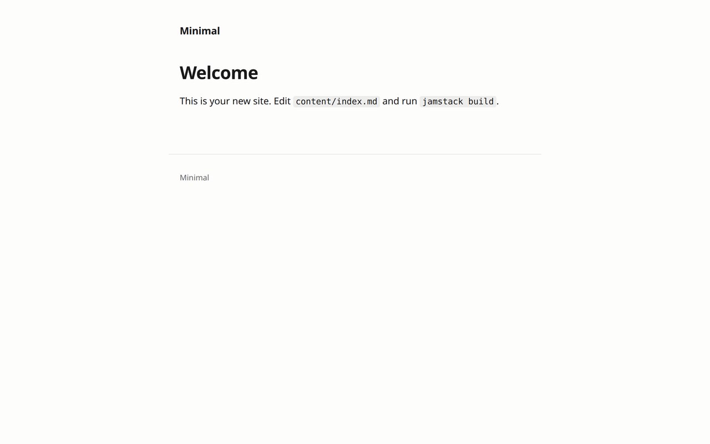
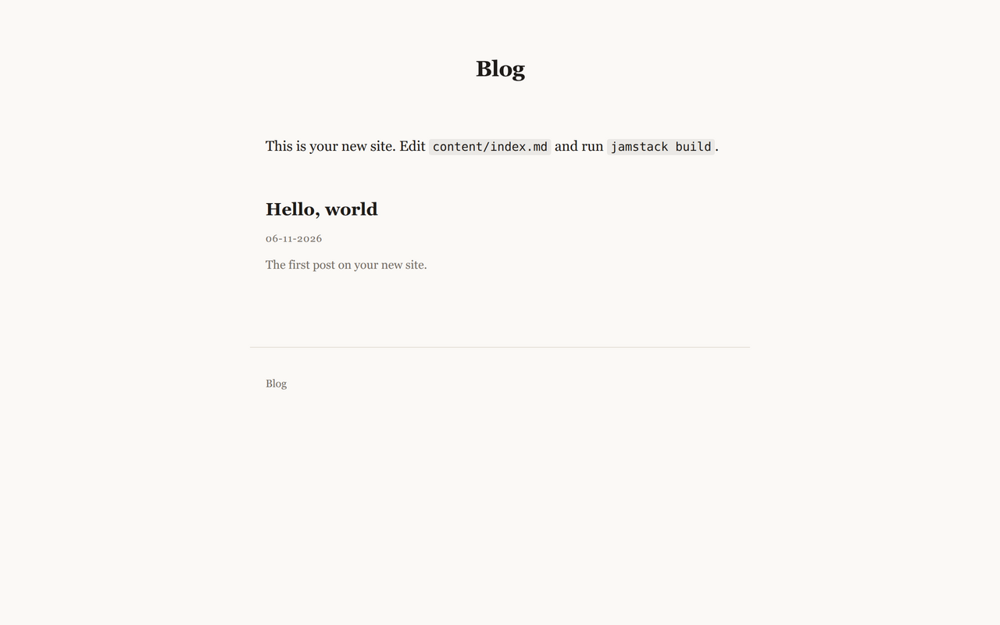
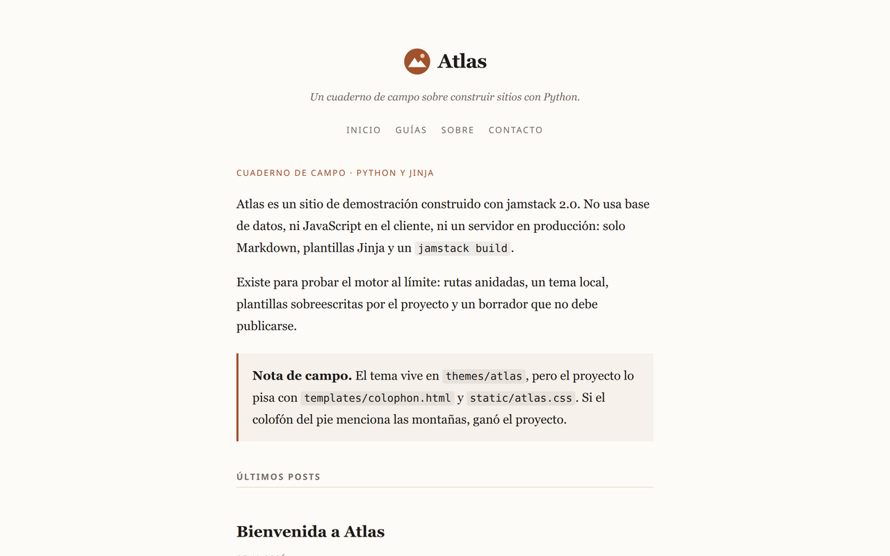
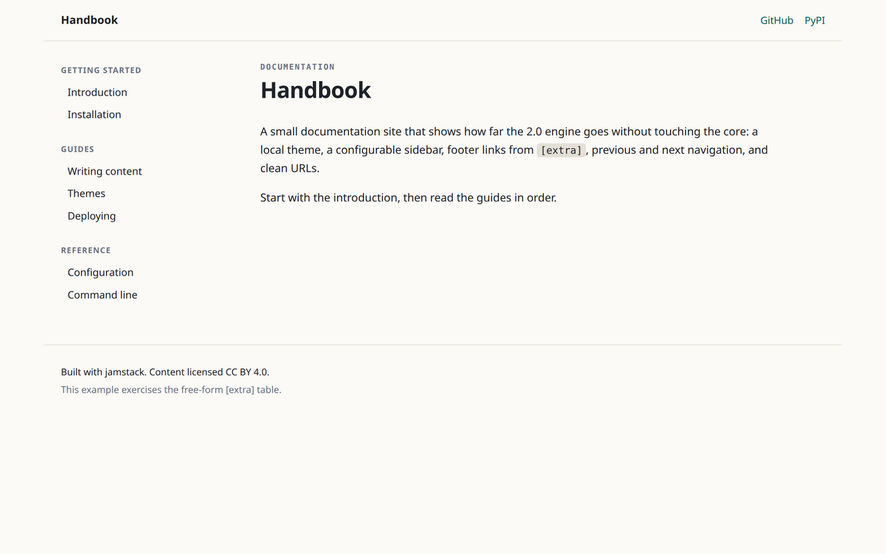

# Showcase

Four sites built with the same engine. Each one lives under
[`examples/`](https://github.com/jamstackpy/jamstack/tree/stable/examples) and
is compiled in CI, so these screenshots match what the code produces.

## Minimal

The smallest possible site: one Markdown page and the bundled `minimal` theme.
A good starting point for a landing page.

## Blog

Dated posts, a feed and a sitemap. Shows the `blog` theme and how `date` and
`summary` shape the index.

## Atlas

A local theme copied into the project: nested routes, a guide index, reading
time computed in Jinja, template and static overrides, and a themed 404.

## Handbook

A documentation layout with a sidebar built from front matter (`section`,
`order`), a configurable section order through `[extra.sidebar]`,
previous/next links and footer content from `[extra]`.
